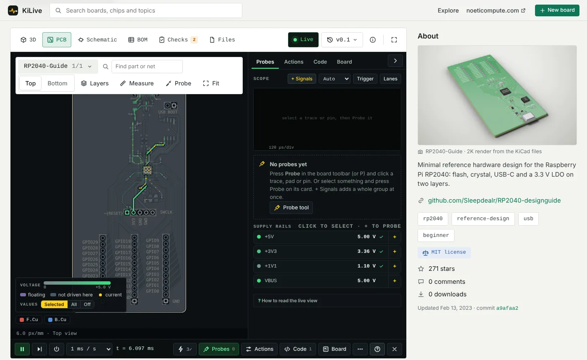

# KiLive

Browser viewer and circuit simulator for KiCad 6+ projects. Open any public GitHub repository or local files; runs client-side, without a server or account.

Live: https://streboreziert.github.io/kilive/



## Features

| Area | Function |
| --- | --- |
| Views | PCB (layers, measure), schematic (multi-sheet), 3D, BOM, design checks; cross-probing between views |
| Simulation | Whole-board transient simulation: sparse MNA, backward Euler, Newton iteration. Probe any net, scope, rail monitor, copper current paths |
| Part models | Regulators, converters, op-amps, switches, LEDs, chargers, translators, logic; chip type inferred from part number and pin names |
| Firmware | Instruction-level emulation: RP2040, AVR, ARM Cortex-M, RISC-V. Peripheral models for sensors, memories, displays, LED chains. Arduino-style code editor |
| Import | GitHub link (`#gh/owner/repo`), `.kicad_pcb` + `.kicad_sch` / folder / `.zip` upload, KiCad plugin, schematic editor with auto-placed layout |
| Export | KiCad files, BOM, ngspice netlist |
| Examples | 10 bundled boards ([BOARDS.md](BOARDS.md)); 116 more open-hardware repositories listed as one-click GitHub links |
| Revisions | Saved boards keep revisions; visual diff between revisions |

The simulation is approximate. Unmodelled chips are replaced by stand-ins; check results against measurement.

## Run

| Mode | Command | Storage |
| --- | --- | --- |
| Hosted | open the link above | browser IndexedDB |
| Local | `./start-kilive.sh` (macOS: `Start KiLive.command`, Windows: `Start KiLive.bat`) | `local-data/*.json` |
| Self-hosted | `python3 scripts/build_site.py`, serve `dist/` | browser IndexedDB |

Requirements: Python 3.8+ for local and self-hosted modes. No other dependencies.

## Open from GitHub

Paste a repository or folder link on the start page, or link directly:

```
https://streboreziert.github.io/kilive/#gh/<owner>/<repo>
https://streboreziert.github.io/kilive/#gh/<owner>/<repo>@<branch>/<folder>
```

Badge for a project README:

```markdown
[](https://streboreziert.github.io/kilive/#gh/<owner>/<repo>)
```

Only the selected project's `.kicad_pcb`, `.kicad_sch` and `.kicad_pro` files are downloaded, from `raw.githubusercontent.com`.
One GitHub API call per open; unauthenticated limit is 60 per hour per IP. Private repositories: upload a `.zip`.

## KiCad plugin

| Package | Function | KiCad | Install |
| --- | --- | --- | --- |
| **KiLive** (`kilive-kicad-*.zip`, [Releases](../../releases)) | Toolbar button opens the open board in the bundled app, served from `127.0.0.1`. Includes unsaved edits (KiCad 7+). Saving or pressing again updates the open tab. Offline | 7–9 | Plugin and Content Manager → Install from File… |
| Send to KiLive (app menu: KiCad → Get the KiCad plugin…) | Copies the project to the clipboard for the hosted app | 6–10 | Install from File…, or IPC version into `Documents/KiCad/<version>/plugins` |

Build the package locally: `python3 kicad-plugin/build_pcm.py` → `dist/kilive-kicad-<version>.zip`.
Without KiCad: `python3 kicad-plugin/boards/noeti_server.py path/to/board.kicad_pcb`.

## Repository

| Path | Content |
| --- | --- |
| `app/` | web app: `index.html`, `js/` (one file per module), `data/`, `photos/`, `thumbs/` |
| `datasheet/` | datasheet → reference design reader |
| `kicad-plugin/` | KiCad plugins: `boards/` (KiLive, local server), `swig/` + `ipc/` (Send to KiLive), `build_pcm.py` |
| `tools/` | Python import pipeline (KiCad repos → `app/data`), example selection (`split_library.py`), license audit |
| `scripts/` | site build, local server, runtimes |
| `qa/` | Playwright tests; CI runs `qa/static_smoke.py` |

Code map, build and test details: [docs/DEVELOPING.md](docs/DEVELOPING.md). Contributing: [CONTRIBUTING.md](CONTRIBUTING.md).

## License

| Component | License |
| --- | --- |
| KiLive code | MIT, © 2026 Roberts Treize ([LICENSE](LICENSE)) |
| Bundled board designs | per source repository ([BOARDS.md](BOARDS.md)) |
| avr8js, rp2040js, PDF.js | MIT, MIT, Apache-2.0 ([THIRD_PARTY_NOTICES.md](THIRD_PARTY_NOTICES.md)) |

KiLive is made by [Noeti](https://noeticompute.com), Riga.
